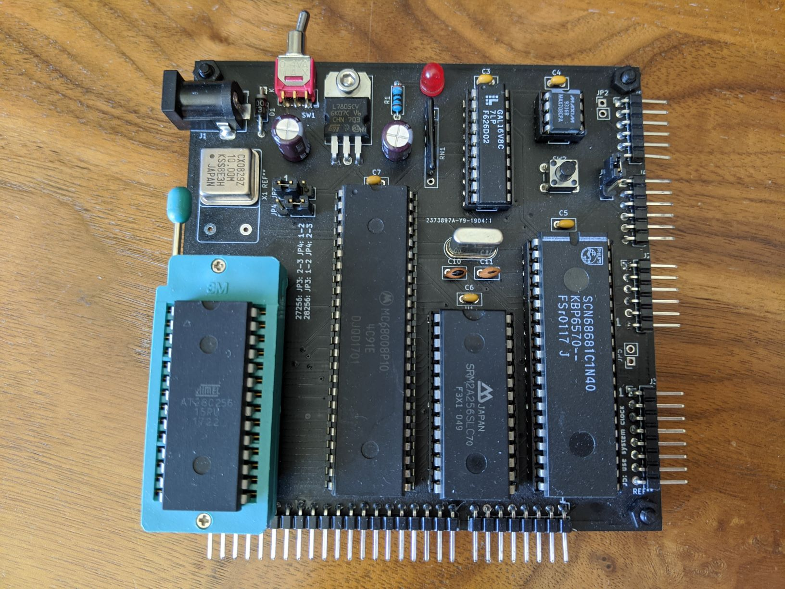
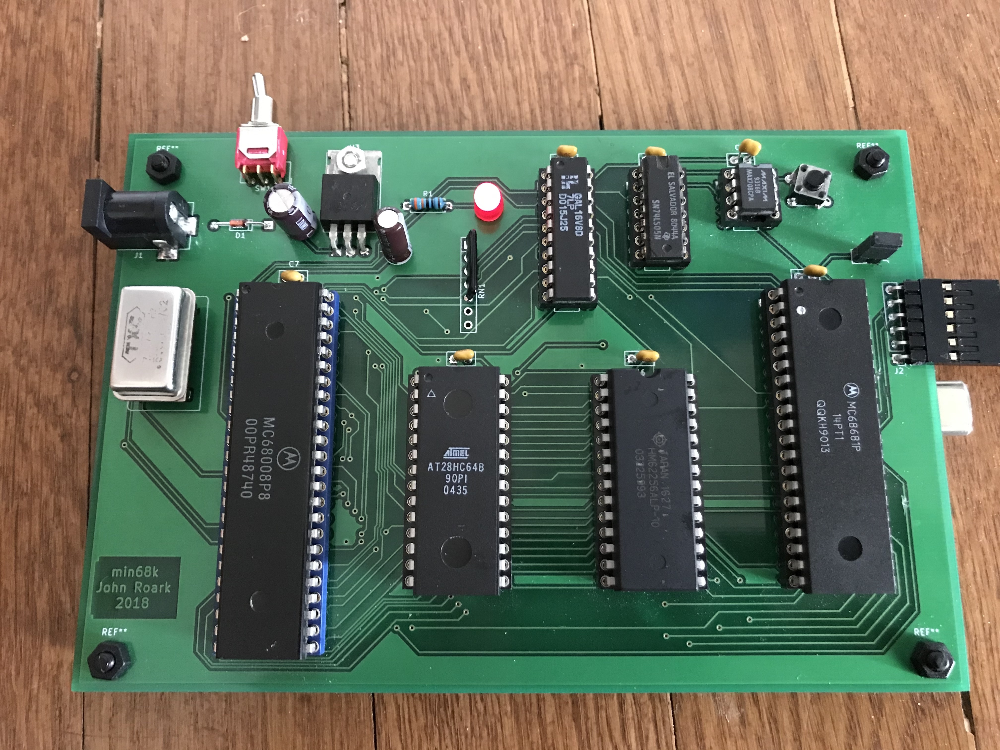
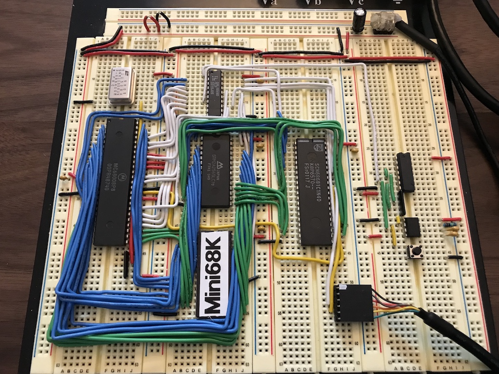
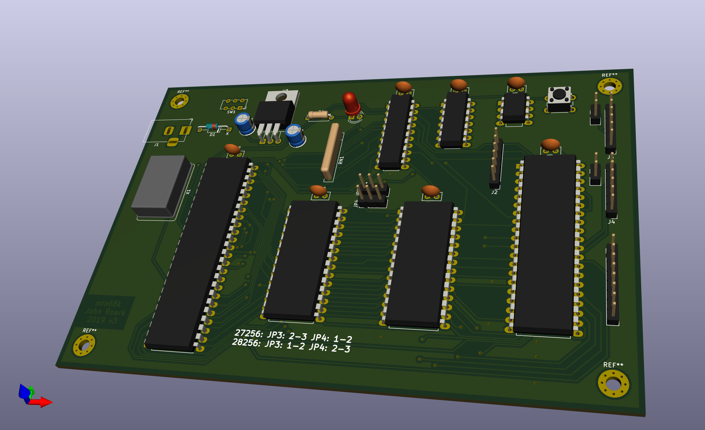

# mini68k









`mini68k` is a small 68008 single-board computer based on the design at
http://www.christle.us/index.php?P=4.

The repository now includes both the board BIOS and a usable emulator for the
current hardware revisions. The emulator is aimed at BIOS bring-up and console
use, not cycle-exact emulation.

## Current status

- BIOS source and ROM build flow live under [bios/](bios/README.md)
- A Rust-based emulator lives under [emulator/](emulator/README.md)
- `v1` support covers the serial-console hardware: 68008-compatible CPU
  behavior, ROM, RAM, and SCC68681 DUART channel A
- `v2` support adds one video processor, either a Yamaha V9938 or a TI
  TMS9918A, each with a BIOS driver: a scrolling text console, bitmap drawing
  and sprites through the same `TRAP #0` API, and a `G` graphics demo in the
  monitor. The emulator models each chip's screen modes, sprites, timing and
  interrupts, plus the V9938's command engine.
- v2 hardware is a 100x100 system board with a VDP bus on its bottom edge,
  plus two plug-in VDP boards (V9938 or TMS9918A, one fitted at a time); see
  [hw/mini68k-v2/NOTES.md](hw/mini68k-v2/NOTES.md)

## Quick start

The supported development path is the Docker-based toolchain in this repo:

```sh
docker compose build dev
make bios-docker
make emu-build
make emu-test
make emu-run
```

`make emu-run` builds `bios/bios.bin` inside the container and starts the
emulator against it. A successful boot reaches the BIOS serial prompt:

```text
Mini 68008 BIOS
>
```

For the v2 video path, build the V9938-enabled ROM and run the emulator in
`v2` mode. Type `G` at the prompt for the graphics demo and `T` to return to
text:

```sh
make bios-docker V9938=1
make emu-run V9938=1 EMU_ARGS="--machine v2 --video window"

make bios-docker TMS9918=1
make emu-run TMS9918=1 EMU_ARGS="--machine v2 --vdp tms9918a --video window"
```

When `EMU_ARGS` includes `--video window`, `make emu-run` builds the BIOS in
Docker but runs the emulator on the host so it can open a desktop window.

To see the video BIOS in action, `make demo-run` builds the bouncing-ball demo
in [demos/](demos/) and opens the emulator with it running (add `TMS9918=1`
for the TMS9918A):

```sh
make demo-run
make demo-run TMS9918=1
```

## BIOS

Build the BIOS locally if you already have a 68k cross assembler and linker:

```sh
make -C bios
```

For emulator use, build a raw binary ROM image instead of the default S-record
output. Add `V9938=1` or `TMS9918=1` (not both) for the v2 video BIOS:

```sh
make -C bios FORMAT=binary
make -C bios FORMAT=binary V9938=1
make -C bios FORMAT=binary TMS9918=1
```

See [bios/README.md](bios/README.md) for BIOS-specific build and ROM programming
details, including the `TRAP #0` video API.

## Emulator

The emulator models two board profiles:

- `v1`: Musashi-backed CPU, ROM, RAM, and DUART console
- `v2`: the same base machine plus one VDP (`--vdp v9938|tms9918a`), with
  its screen modes, sprites, video timing, and host window rendering

The v1 GAL only decodes `A16:A15`, so the memory map aliases across the 20-bit
address space like the real hardware. The v2 path additionally qualifies `A14`
inside the `11` region so the DUART and VDP can coexist at their short-address
aliases.

See [emulator/README.md](emulator/README.md) for implementation details and
current limitations.

## Docker development environment

The repository includes a containerized cross-development environment in
[docker/](docker/) and [docker-compose.yml](docker-compose.yml). It provides:

- Rust 1.85 with `rustfmt`
- `m68k-unknown-elf-as` and `m68k-unknown-elf-ld` compatibility symlinks
- GNU m68k cross-binutils and cross-GCC packages

Useful top-level targets:

- `make bios-docker`: build `bios/bios.bin` in the container; pass `V9938=1`
  or `TMS9918=1` for a v2 ROM
- `make emu-build`: build the emulator in release mode
- `make emu-test`: run the emulator unit and integration tests
- `make emu-run`: boot the BIOS in the emulator; pass `EMU_ARGS` through to the
  CLI
- `make dev-shell`: open a shell inside the dev container

The checked-in `crosstool-ng.sparseimage` remains available as an optional local
workaround, but it is no longer the primary documented workflow.
